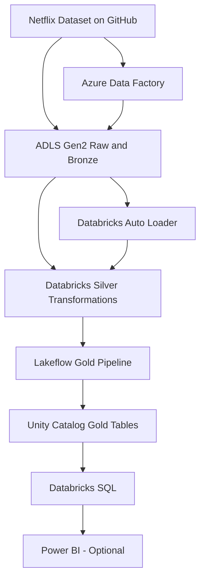

# Netflix Azure Data Engineering Pipeline

An end-to-end data engineering project that ingests Netflix data into Azure Data Lake Storage Gen2, transforms it with Azure Databricks and PySpark, and publishes curated, quality-checked Gold datasets through Unity Catalog.


## Architecture





> **Storage note:** The Gold outputs are Unity Catalog-managed Materialized Views. They are **not** written to the separate Azure Blob container named `gold`, so that container can remain empty even after a successful pipeline run.

## Tech stack

| Layer | Technology | Role |
| --- | --- | --- |
| Ingestion | Azure Data Factory | Parameterized HTTP/CSV ingestion with ForEach |
| Storage | Azure Data Lake Storage Gen2 | Raw, Bronze and Silver data zones |
| Incremental ingestion | Azure Databricks Auto Loader | Ingest Netflix Titles into Bronze Delta |
| Transformation | PySpark and Delta Lake | Data preparation and Delta-format output |
| Orchestration | Databricks Jobs | Coordinate four lookup datasets and Titles processing |
| Serving | Lakeflow Spark Declarative Pipelines | Publish Gold Materialized Views |
| Governance | Unity Catalog | Organize and query Gold datasets |
| Analytics | Databricks SQL | Query the curated data; Power BI connectivity is optional |

## Pipeline workflow

### 1. Ingest to Bronze
- Azure Data Factory ingests the four lookup CSV files: `netflix_cast`, `netflix_category`, `netflix_countries`, and `netflix_directors`.
- Databricks Auto Loader ingests Netflix Titles from the Raw area and writes Delta data to Bronze.

### 2. Transform to Silver
- The parameterized Silver notebook processes each lookup dataset and saves it as Delta.
- The Silver Titles notebook cleans and transforms title records using PySpark, including null handling, data-type conversion, de-duplication, string operations, and conditional flags.
- The `Netflix_Bronze_to_Silver` job orchestrates the lookup and Titles tasks.

### 3. Publish Gold
- The `Netflix_GoldPipeline` Lakeflow pipeline reads the five Silver Delta datasets.
- It defines four lookup Materialized Views and a Titles pipeline with staging and transformation views.
- Expectations enforce conditions such as `show_id IS NOT NULL`, with invalid records dropped from the affected Gold outputs.
- Gold datasets are published in `netflix_adb_yb.gold_schema`.

## Gold datasets

- `gold_netflix_cast`
- `gold_netflix_category`
- `gold_netflix_countries`
- `gold_netflix_directors`
- `gold_netflix_titles`

## Example query

```sql
SELECT type, COUNT(*) AS total_count
FROM netflix_adb_yb.gold_schema.gold_netflix_titles
GROUP BY type;
```

## Repository contents

- [`adf/`](adf/): Azure Data Factory pipelines and related source-controlled JSON resources.
- [`databricks/`](databricks/): exported Databricks notebooks for ingestion, Silver transformations, and Gold pipeline definitions.

## Implementation notes

- This repository contains project source and configuration, **not** a running Azure environment.
- Azure resources, external locations, access permissions, and secrets must be configured independently to reproduce the pipeline.
- **Do not commit secrets:** storage keys, SAS tokens, passwords, connection strings, client secrets, or access tokens.
- The source-code folders and exact filenames may vary between Databricks exports.

## Credits

Project developed as a hands-on implementation using the Netflix Azure Data Engineering tutorial/data resources from [anshlambagit/Netflix_Azure_Data_Engineering_Project](https://github.com/anshlambagit/Netflix_Azure_Data_Engineering_Project). This repository documents the project setup and implementation; original datasets and tutorial materials belong to their respective authors.
